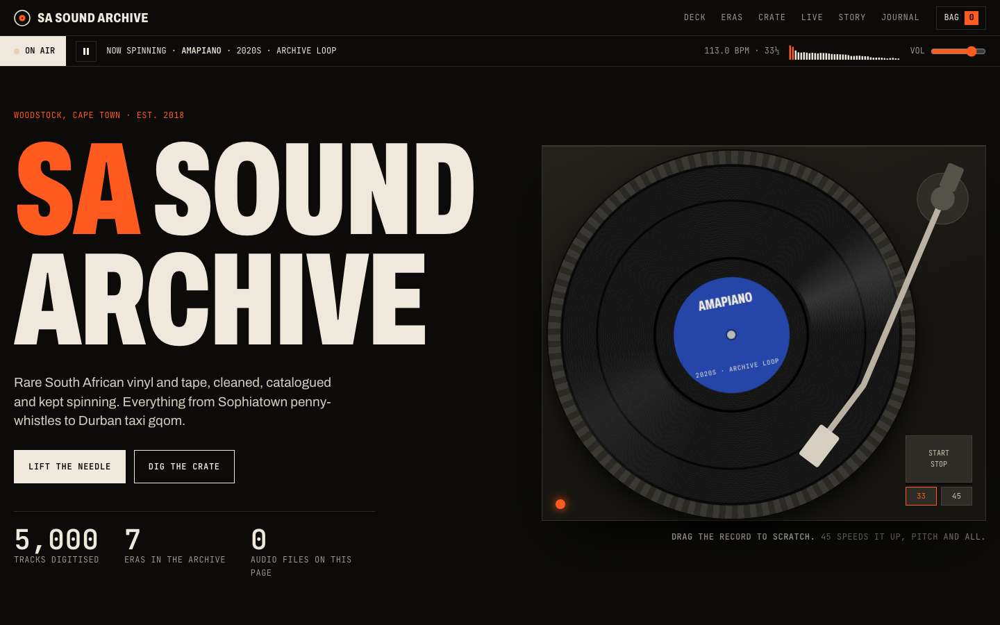

# SA Sound Archive

A rebuild of a website I made in second year on Wix: a fictional Cape Town store that sells rare South African vinyl and cassettes. The original was a stock template. This version has a turntable you can scratch, a scrolling history of seven South African genres, and a 3D record crate to flip through. Every sound on the page is synthesised in the browser, so the site ships no audio files.

[**Live site**](https://sa-sound-archive.vercel.app) · [Original Wix site](https://elliotzubair.wixsite.com/sa-sound-archive)

<a href="https://sa-sound-archive.vercel.app"></a>

## What's on the page

- **The deck.** A turntable whose platter angle is the playhead. Drag the record and the audio follows your hand, backwards too. Press stop and the platter coasts down, so the pitch sags the way a real deck does. Switching to 45 rpm speeds up both the record and the music.
- **Seven eras.** Kwela, mbaqanga, Cape jazz, bubblegum, kwaito, gqom and amapiano. Each has a short, sourced history and its own loop to play. On desktop the section is pinned and scrolls sideways.
- **The crate.** Nine records (the products from the original site) in a 3D crate. Flip with arrows, swipe or the keyboard. Sleeves are designed in CSS over duotoned photos. Pick one to see its details, play it on the deck or add it to the bag.
- **Bag, event and newsletter.** The bag persists in `localStorage`. The event ticket counts down to the show and can download an `.ics` file. Checkout and the newsletter are demos with nothing behind them.

## How the audio works

Each genre is a short pattern written as step strings (`'X...x...X...x...'`) plus chord and melody lists. Instruments are built from Web Audio oscillators, filtered noise and envelopes: a log drum is a sine with a fast pitch drop, a penny-whistle is a triangle wave with delayed vibrato.

When a record goes on the deck, its four bars are rendered once into an `OfflineAudioContext` (about 100 ms). The release tail is folded back onto the start so the loop has no seam, and a reversed copy is kept for backspins. While it plays, every animation frame sets the buffer's `playbackRate` from the platter's angular velocity, switching to the reversed buffer when the record moves backwards. Vinyl crackle is a separate noise loop that follows the platter speed.

## Design

I benchmarked music sites first (screenshots in `docs/reference/`). The layout follows [NTS Radio](https://www.nts.live): a dark grid, condensed caps and a persistent on-air bar that shows what's playing. The record sleeves borrow from Analog Africa's reissues of 1970s South African covers. Type is Archivo, with its width axis at 62% for the display text, and JetBrains Mono for the catalogue details.

Photos are places, not artists: Soweto, Durban's taxi ranks, the Cape Town carnival and Johannesburg at night, all from Wikimedia Commons and credited in the footer. Artists appear only as history, so the page doesn't suggest that real musicians endorse a store that doesn't exist.

## Stack

A single `index.html`, with no build step. GSAP 3.13 and ScrollTrigger from cdnjs, Lenis from jsDelivr. Photos are WebP in `img/`.

```sh
python3 -m http.server 4321   # then open http://localhost:4321
```

Navigation links jump straight to a section inside a View Transition crossfade instead of smooth-scrolling through the pinned eras. Reduced-motion users get a normal scrolling page with no pinning.
